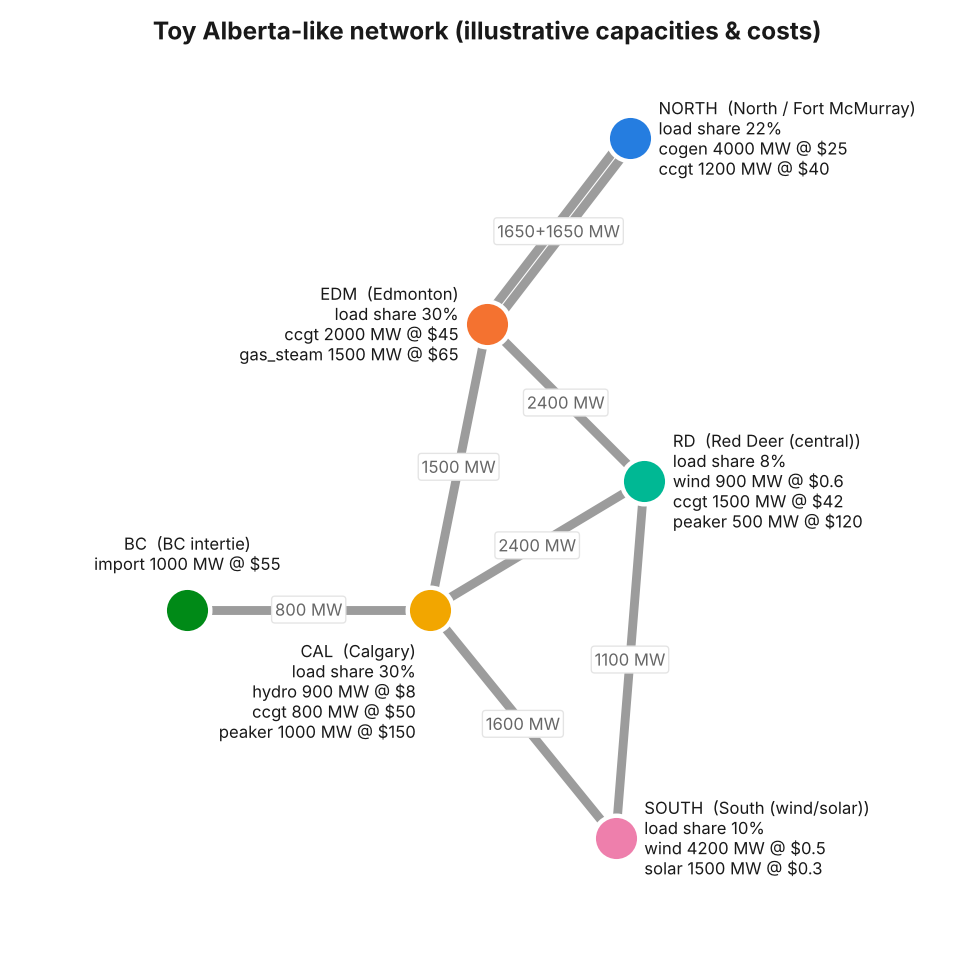
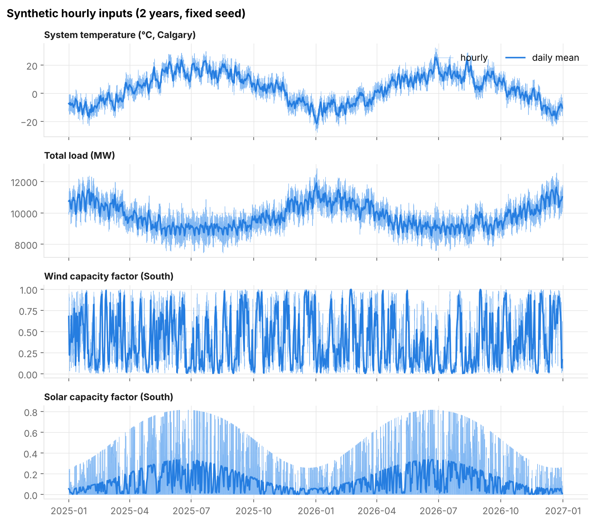
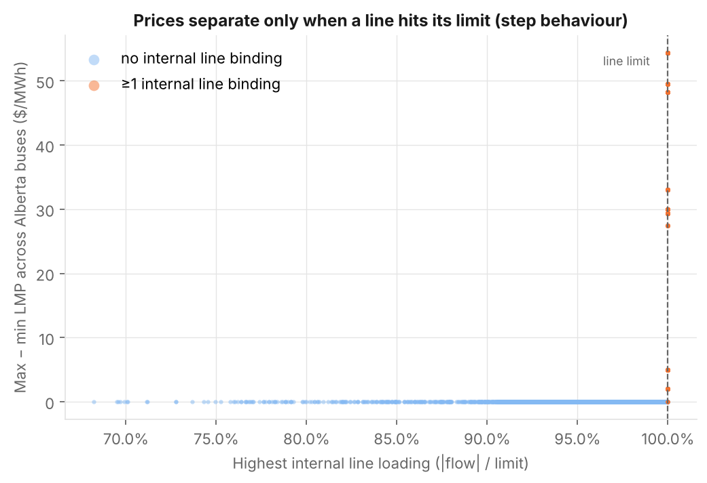
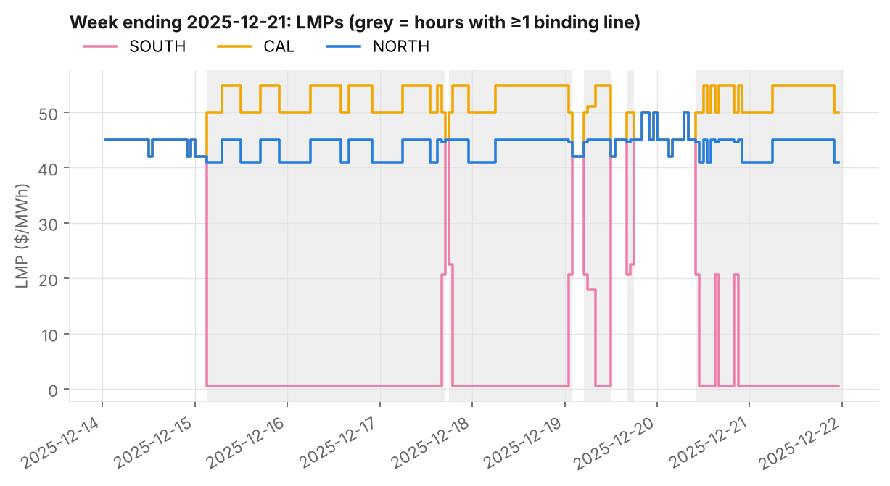
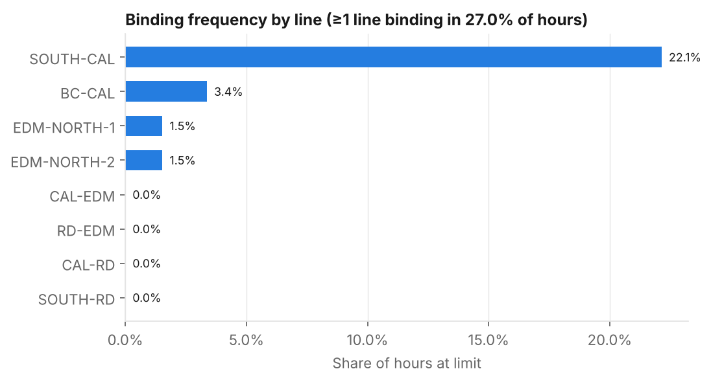

# Probabilistic congestion assessment for a future nodal market, with ML surrogates for speed

A proof-of-concept on a **simplified, Alberta-inspired 6-bus grid**. Alberta's AESO plans to move from a single
province-wide pool price to **Locational Marginal Prices (LMPs)** around 2028, so there is no historical Alberta
LMP data to learn from. This project therefore:

1. **simulates** hourly LMPs and congestion with a DC optimal power flow (PyPSA + the open-source HiGHS solver),
2. runs **probabilistic (Monte Carlo) and N-1 contingency studies** on top of it *(Phase 2)*,
3. trains **ML surrogates** that approximate the OPF much faster, and checks honestly where they fail *(Phase 3)*,
4. stores everything in **SQL** and shows it in a **Streamlit** dashboard *(Phase 4)*,
5. calibrates load and wind/solar shapes against **real AESO data** *(Phase 5)*.

> **Status:** Phase 1 complete. Phases 2–5 are planned (see [Roadmap](#roadmap)).

> ⚠️ **This is a DC approximation.** DC-OPF assumes lossless lines, flat voltage magnitudes and small angle
> differences, and ignores reactive power and voltage limits entirely. All capacities, costs and line ratings are
> **made up and illustrative**, loosely shaped like Alberta — they are not AESO data.

---

## What is an LMP? (the two-town example)

Picture two towns joined by one transmission line that can carry **100 MW**.

* **Town A** has a wind farm: 300 MW available, costs about **\$0.5/MWh** to run.
* **Town B** has a gas plant costing **\$50/MWh**, and it needs **150 MW**.

The cheapest dispatch is to send as much wind as possible from A to B. But the line fills up at 100 MW, so the
gas plant in B has to supply the remaining 50 MW.

The **LMP** at a location is the cost of serving *one more MW there*:

* One more MW in **B** cannot come over the full line, so the gas plant produces it: **LMP_B = \$50**.
* One more MW in **A** comes from the wind farm, which still has spare capacity: **LMP_A = \$0.5**.

The \$49.5 difference is the **congestion price**. Multiplied by the 100 MW flow it gives a congestion rent of
\$4,950/h, collected by the market operator. If the line could carry 200 MW, wind would serve all of B, both towns
would pay \$0.5, and there would be no congestion.

Two properties follow from this, and both matter later in the project:

* **Prices jump.** While the line is below its limit there is a single price. The moment it hits the limit, prices
  split by tens of dollars. In other words, LMP is a step function of the inputs.
* **In a meshed grid, power splits over every path in inverse proportion to line reactance.** This *loop flow* can
  push an LMP **above every offer in the system**. In the three-bus test in `tests/test_phase1.py` (offers of \$10
  and \$40), the load bus clears at **\$70/MWh**: serving one more MW there means backing down 1 MW of the \$10 unit
  and adding 2 MW of the \$40 unit.

Both examples are executable tests (`pytest -q`) and are shown in `notebooks/01_phase1_walkthrough.ipynb`.

---

## The toy network



| Bus | Role (illustrative) | Load share | Generation (MW @ \$/MWh) |
|---|---|---:|---|
| NORTH | Fort McMurray: oil-sands cogeneration, industrial load | 22% | cogen 4000 @ 25, CCGT 1200 @ 40 |
| EDM | Edmonton | 30% | CCGT 2000 @ 45, gas steam 1500 @ 65 |
| RD | Red Deer, central hub | 8% | wind 900 @ 0.6, CCGT 1500 @ 42, peaker 500 @ 120 |
| CAL | Calgary | 30% | hydro 900 @ 8 (seasonal), CCGT 800 @ 50, peaker 1000 @ 150 |
| SOUTH | Wind and solar region | 10% | wind 4200 @ 0.5, solar 1500 @ 0.3 |
| BC | Intertie to BC (import only) | — | import 1000 @ 55, behind an 800 MW intertie |

The network has eight AC circuits with two loops: SOUTH–CAL–RD and CAL–RD–EDM. NORTH connects through a
**double-circuit** corridor. A single circuit outage therefore does not island the North, but it does load the
parallel circuit; this is the case Phase 2's N-1 study will examine. Each load bus also has an unserved-energy
generator priced at the **\$999.99/MWh** price cap (used as the value of lost load, VOLL), so every outage
combination has a feasible solution.

All parameters live in [`config.yaml`](config.yaml), including the random seed, every capacity, cost and rating,
and every weather and load process parameter.

---

## How to run

```bash
pip install -r requirements.txt
```

```bash
python -m src.run
```

```bash
pytest -q
```

`python -m src.run` runs every implemented phase (currently Phase 1, ≈1.5 min on 4 cores). Use
`python -m src.run --phases 1` to run Phase 1 only. `pytest -q` runs 8 correctness tests in about 10 s.

* Outputs go to `data/` as parquet files; this folder is git-ignored and can be regenerated.
* Figures and summaries go to `reports/` and are committed.
* The walkthrough is `notebooks/01_phase1_walkthrough.ipynb`.

### Repository layout

```
config.yaml          all parameters (seed, network, generators, weather/load processes)
src/config.py        load + validate config
src/synth.py         synthetic temperature, load, wind, solar, hydro
src/grid.py          PyPSA network builder; PTDF matrix
src/simulate.py      block-wise hourly DC-OPF, LMP/flow/binding extraction
src/checks.py        sanity checks incl. an independent angle-based DC-OPF
src/plots.py         figures
src/run.py           one-command pipeline
tests/               pytest suite (two-town, loop flow, determinism, physics)
notebooks/           walkthrough
reports/             generated summaries and figures (committed)
```

---

## Phase 1 — synthetic grid and LMP simulator

### Synthetic inputs

The inputs cover two years of hourly data (17,520 hours) on a naive calendar with no DST, generated from a fixed
seed. Each stochastic process uses its own child random stream, so changing one parameter does not reshuffle the
others.

* **Temperature (°C):** an annual cosine (coldest around 15 January), a daily cosine (warmest at 15:00) and a
  persistent AR(1) weather anomaly (φ = 0.985/h), plus small offsets and noise per bus (the North is 3 °C colder).
* **Load per bus:** a share of system load × hour-of-day shape × weekend factor (0.94) × a heating term
  (+1.1% per °C below 15 °C) and a cooling term (+1.5% per °C above 20 °C) × 1.5% noise. The North is industrial
  and keeps only 25% of that variation. The result is a mean load of 9.8 GW and a peak of 12.8 GW.
* **Wind:** CF = sigmoid(seasonal mean + AR(1) anomaly). It is windier in winter, the two sites are correlated
  (ρ = 0.7), and the mean CF is about 0.38.
* **Solar:** clear-sky output from solar elevation at 50°N × (1 − an AR(1) cloud factor). It is zero at night and
  low in winter.
* **Hydro:** monthly availability with a June–July freshet.



### Results (from [`reports/phase1_summary.md`](reports/phase1_summary.md))

| Metric | Value |
|---|---:|
| Hours simulated | 17,520 |
| DC-OPF wall time, all hours | **≈40–50 s** (24 monthly LPs, ≈2 s each) |
| Hours with ≥1 binding line | **27.0%** (target 10–30%); internal lines only: 23.7% |
| Hours with load shedding | 0 |
| Mean / P95 max−min LMP spread across Alberta buses | \$10.5 / \$49.5 per MWh |
| Same spread with no line limits | 5e-15 (a single price, as it should be) |

| Line | Share of hours at limit |
|---|---:|
| SOUTH–CAL | 22.1% |
| BC–CAL (intertie) | 3.4% |
| EDM–NORTH (each circuit) | 1.5% |
| SOUTH–RD, CAL–RD, RD–EDM, CAL–EDM | 0.0% |

| Bus | Mean LMP with line limits | Mean LMP with no limits |
|---|---:|---:|
| NORTH | 45.26 | 44.51 |
| EDM | 45.31 | 44.51 |
| RD | 44.36 | 44.51 |
| CAL | 47.22 | 44.51 |
| SOUTH | **36.75** | 44.51 |
| BC | 46.85 | 44.51 |

Most congestion comes from **wind in the south**. When SOUTH–CAL is full, SOUTH's price collapses to the wind offer
(\$0.5) and Calgary's price rises. CAL and RD prices are often *mixtures* of offers, set through the PTDF weights of
the binding line, which is loop flow at work.



The scatter above is the step behaviour in one picture. The price spread is exactly zero at every loading below
100%, and it is between \$2 and \$55 at the limit.





### Sanity checks (all run automatically by `python -m src.run`)

| Check | Result |
|---|---|
| **Copper plate:** with no line limits every bus has the same price | PASS (max spread 1.4e-14 \$/MWh) |
| **Independent re-solve:** 200 random hours (half of them congested) re-solved with an angle-based DC-OPF written directly in `scipy.optimize.linprog` (HiGHS), without PyPSA | PASS (max LMP difference 2e-13 \$/MWh, max flow difference 2e-11 MW) |
| **Physics:** power balance, Kirchhoff's current law at every bus, no flow above its limit | PASS (all errors < 1e-11 MW) |
| **Congestion target:** 10–30% of hours with ≥1 binding line | PASS (27.0%) |
| **Unit tests:** two-town prices (\$0.5 / \$50), three-bus loop flow (\$70 above both offers), PTDF, determinism, input ranges, config validation | 8 / 8 pass |

PyPSA writes the KVL constraints as cycle constraints, while the independent check uses bus voltage angles. Their
agreement therefore tests both the formulation and the way results are extracted.

### Engineering notes

* **Hours are solved in blocks.** With no storage, unit commitment or ramping limits, each hour's OPF is independent
  of the others. Solving a month of hours in a single LP gives exactly the same answer as solving them one at a time,
  and pays the model-building overhead 24 times instead of 17,520 times.
* **A line outage removes the line.** In DC-OPF, setting the line's rating to 0 is *wrong*: the KVL constraint stays
  in the model and forces the angle difference across the open line to zero. Generator outages are different and can
  be applied exactly through `p_max_pu`. This matters for Phase 2, where scenarios are grouped by topology.
* **Wind and solar costs are \$0.3–0.6, not \$0.** Small, distinct costs avoid ties and degenerate (non-unique) duals.
  6 of 17,520 hours still show a line exactly at its limit with zero price separation, a degenerate vertex. Phase 3
  defines the congestion label as "at the limit" and documents these hours.
* **Line ratings were tuned by hand** to land in the 10–30% band. Lowering the North corridor rating by just 2%
  (1650 → 1620 MW per circuit) raises its binding share from 1.5% to 11.6%, and the system-wide share from 27% to 37%. Because northern load is flat industrial load, whether that corridor binds is close
  to a yes/no function of its rating. This is a real sensitivity, and Phase 2 will treat it as uncertainty rather
  than hide it.

### Honest observations and limitations of the Phase 1 model

* **Prices are very discrete.** Each bus takes only 10–13 distinct LMP values over two years. A pure cost-based
  merit order without bidding behaviour produces flat price plateaus and **almost no scarcity pricing**: peakers run
  in only 9 hours, and the price never goes above \$120. Real Alberta pool prices are far spikier, because of offer
  behaviour, outages, ramping and the intertie. Phase 2 adds outages and Phase 5 compares against real pool price.
  This model should not be read as a price forecast.
* **No losses, no reactive power, no voltage limits** (DC approximation). Line ratings are static, with no
  seasonal or dynamic ratings.
* **No unit commitment, minimum stable generation, ramping or storage**, so hours are independent. Cogeneration is
  treated as fully dispatchable, although in reality much of it is must-run.
* **The BC intertie is import-only, at a fixed \$55**. There is no export, no Montana/Saskatchewan tie and no BC
  price dynamics.
* **The weather is synthetic and shared** across Alberta (one anomaly plus bus offsets). Real Alberta has regional
  weather differences, and wind/load correlation is only partly represented, through season.
* **Risk of circularity.** The Phase 3 surrogates will learn a data-generating process that I designed. Their
  accuracy measures how well they learn *this simulator*, not the real market.

---

## Roadmap

| Phase | Content | Status |
|---|---|---|
| 1 | Synthetic grid, hourly DC-OPF/LMP simulator, sanity checks | ✅ done |
| 2 | Monte Carlo (load, wind, line and generator outages); N-1 ranking; solve-time budget | planned |
| 3 | Surrogates: copper-plate baseline, per-bus LightGBM + SHAP, multi-output MLP, line-congestion classifier; surrogate MC versus full OPF | planned |
| 4 | SQLAlchemy store (SQLite by default; Postgres/SQL Server through the connection string); Streamlit dashboard | planned |
| 5 | AESO API: real AIL load shape, wind/solar shapes, calibration against pool price (needs `AESO_API_KEY`) | after key is confirmed |

### Next steps beyond this POC

* AC power flow and AC-OPF, to add losses, voltage and reactive power.
* Graph neural networks that use the network topology, so surrogates can generalise across outages.
* Calibrating costs from AESO merit-order data.
* Forced outage rates from AIES generation capacity data.
* Intertie limits taken from AESO intertie reports.
