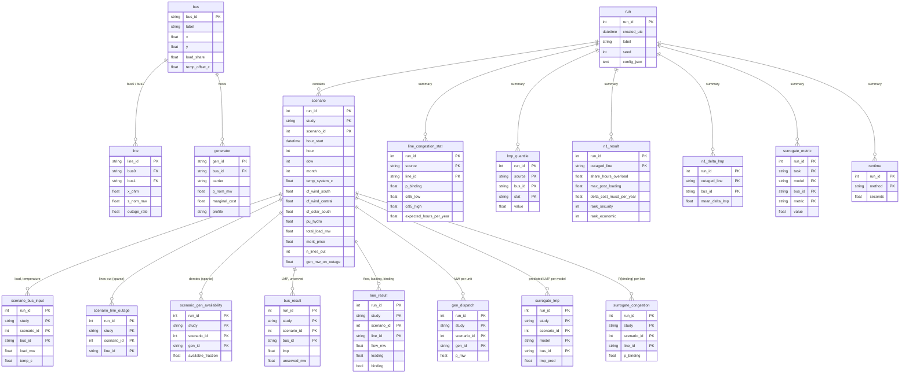

# Database schema

Generated DDL for each dialect: [`sql/schema_sqlite.sql`](../sql/schema_sqlite.sql),
[`sql/schema_postgresql.sql`](../sql/schema_postgresql.sql), [`sql/schema_mssql.sql`](../sql/schema_mssql.sql)
(`python -m src.db --ddl`). Defined once in [`src/db.py`](../src/db.py) with SQLAlchemy Core.

## Design notes

* **`study`** separates the deterministic hourly run (`hourly`) from the Monte Carlo study scenarios (`mc_test`);
  every result table is keyed by `(run_id, study, scenario_id)`, so several runs can live side by side.
* **Long (tidy) result tables** (`bus_result`, `line_result`, ...) instead of one column per bus/line: adding a bus
  or a line needs no schema change, and every SQL engine aggregates them with plain `GROUP BY`.
* **Sparse outage tables**: only lines that are out and generators below full availability are stored
  (1.7k and 51k rows instead of 160k and 260k).
* **Portable types only** (INTEGER, FLOAT, VARCHAR(n), BOOLEAN/BIT, DATETIME, TEXT/NVARCHAR(max)).
  Percentiles are computed in Python because `PERCENTILE_CONT` differs between engines (and SQLite lacks it).
* **Booleans**: `line_result.binding` is BOOLEAN on PostgreSQL/SQLite and BIT on SQL Server. Hand-written SQL should
  compare with `binding = :true` (bound parameter); the dashboard uses SQLAlchemy Core, which compiles the right form.
